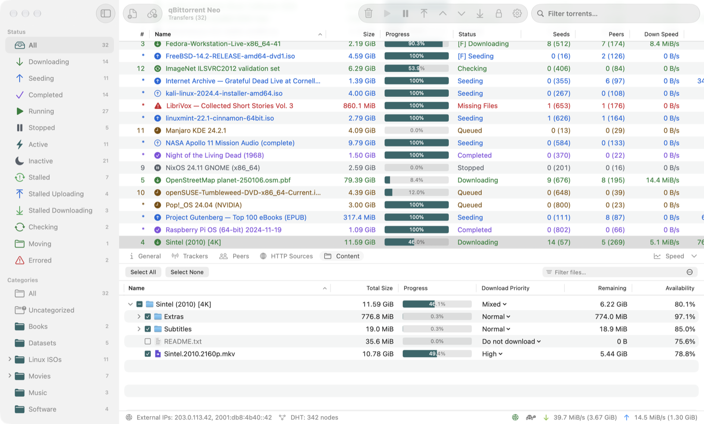
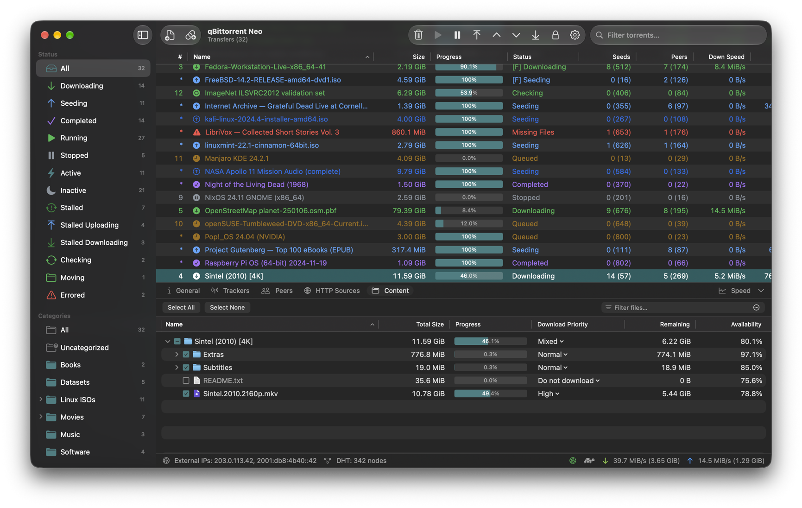
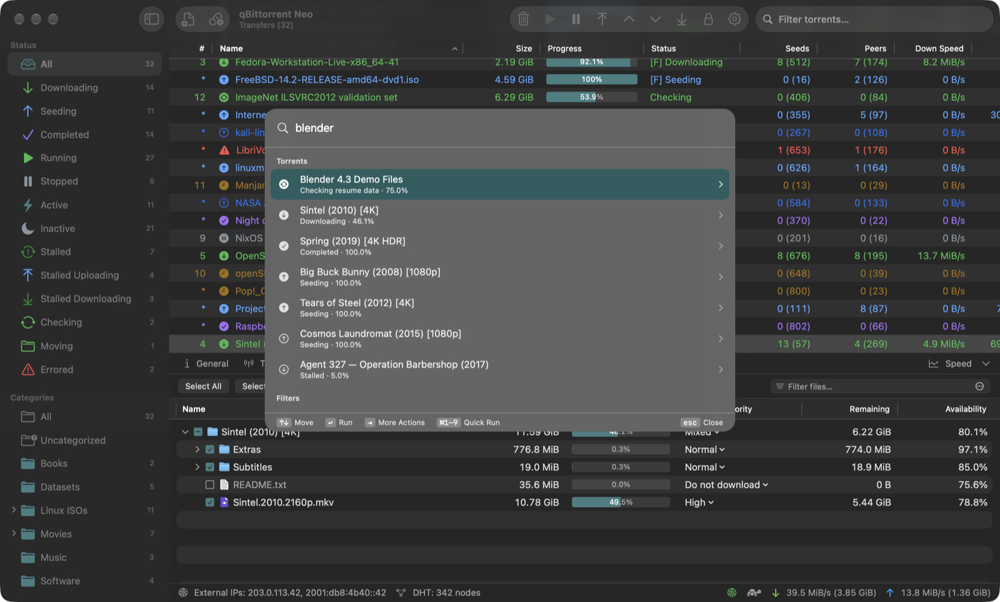
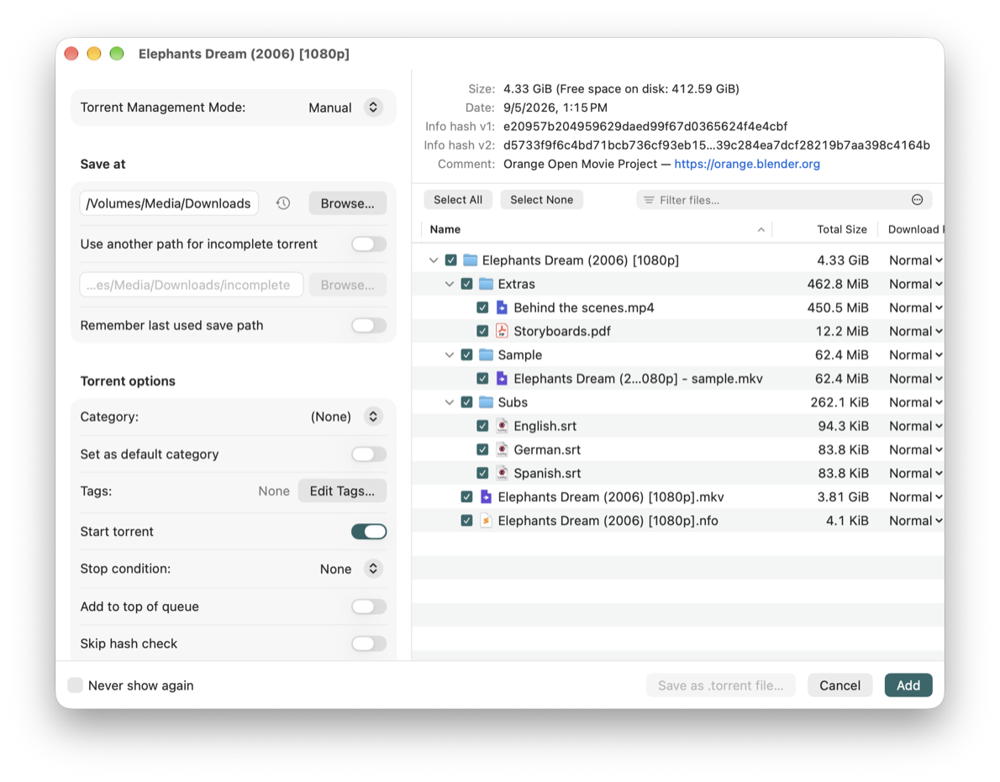
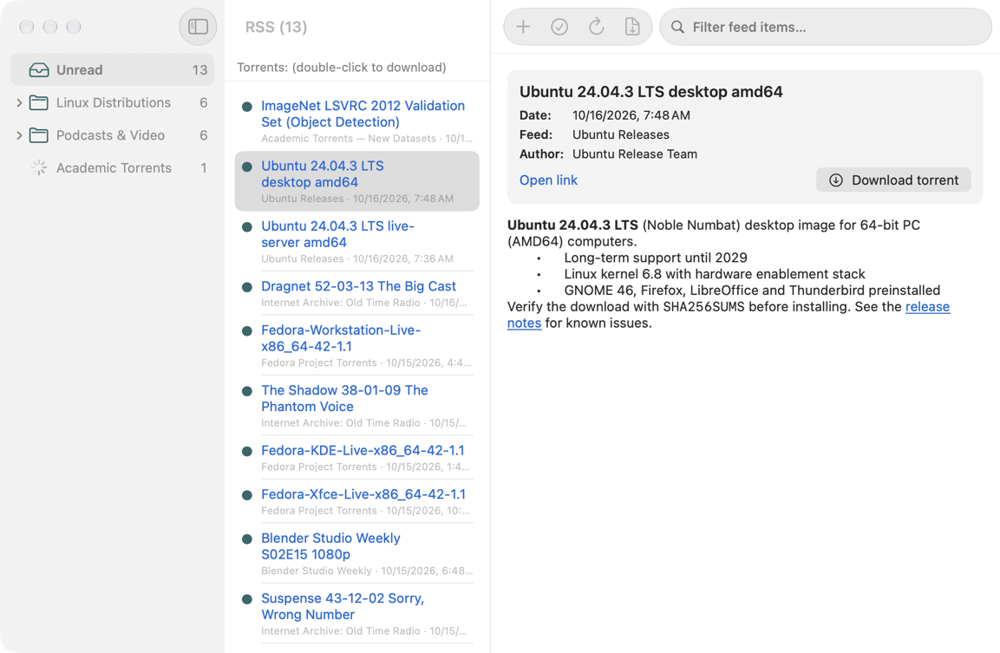
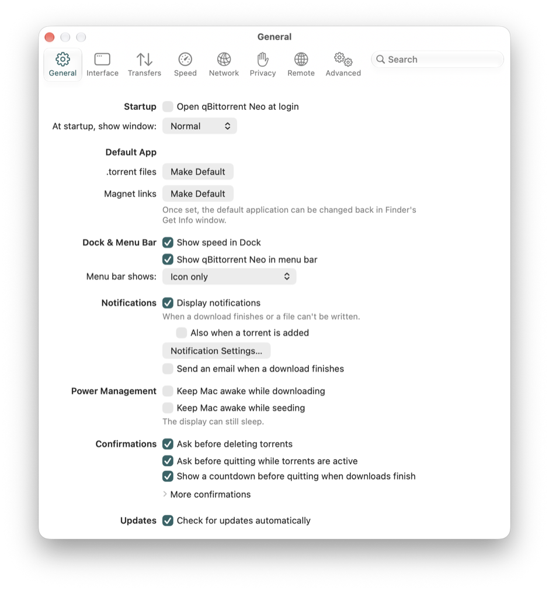
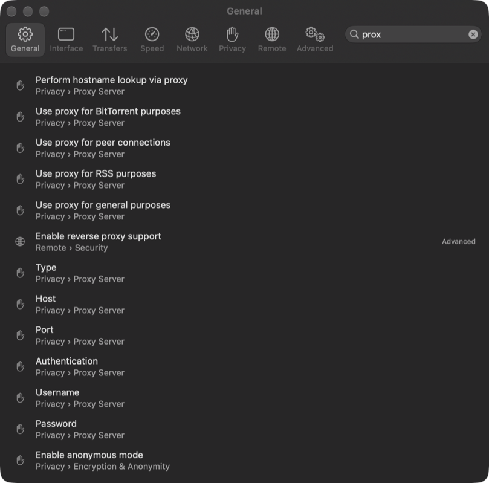
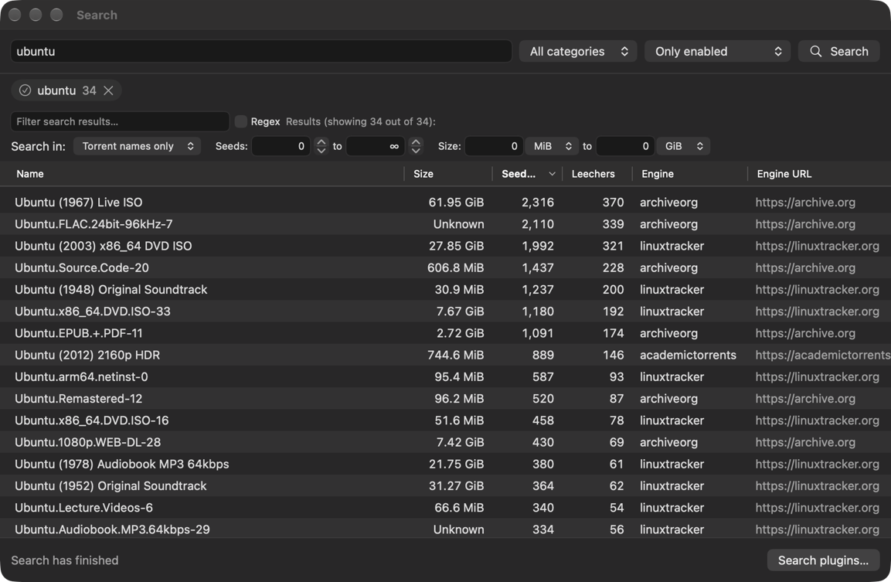

# qBittorrent Neo

**The qBittorrent you know, with a native Mac interface.**

qBittorrent Neo runs the engine of [qBittorrent](https://www.qbittorrent.org) 5.2.4
(the same torrent handling, RSS, search, Web UI and settings) with a new interface
written in SwiftUI for macOS. It looks and behaves like a Mac app, and it keeps all of
qBittorrent's features and settings.

**Website:** [neo.lex.mk](https://neo.lex.mk) · Sibling project on a Rust core: [qBit NeoRS](https://neors.lex.mk)



## Features

**Main window.** A sortable torrent list with qBittorrent's columns, state colors and
progress bars, a toolbar for the common actions, a filter field, and a status bar
with your speeds, DHT nodes and connection status. Drag torrent files or magnet links
onto the window to add them.

**Filters sidebar.** Narrow the list by status (downloading, seeding, stalled,
errored…), category and subcategory, tag or tracker, with live counts.

**Torrent details.** The tabs below the list show General information with the
piece map, Trackers, Peers (with countries), HTTP Sources, Content (choose files,
set priorities, rename) and a speed graph.

**Adding torrents.** The Add Torrent window shows the files before the download
starts: choose a save location, category, tags, file priorities, stop condition and
queue position.

**Settings.** Every qBittorrent option, arranged in a Mac settings window with
toolbar panes (General, Interface, Transfers, Speed, Network, Privacy, Remote,
Advanced). Type in the search field to find any setting and jump straight to it.

**Command palette.** Press **⌘K** to find a torrent, run any command, apply a filter
or open a setting, all from the keyboard.

**Menu bar and Dock.** An optional menu bar item can show your download and upload
speeds and torrent counts, with quick actions in its menu. The Dock icon can show the
current speed as a badge. Finished downloads show a notification.

**RSS reader and downloader.** Subscribe to feeds, read articles, download their
torrents, and set up qBittorrent's automatic download rules (filters, episode
matching, target category and folder).

**Search.** Search torrent sites with qBittorrent's search plugins: install, enable
and update plugins, filter results by seeds and size, and download from the results.
Search plugins need Python 3, as in qBittorrent.

**Torrent creator.** Create v1, v2 or hybrid torrents from a file or folder, with
trackers, web seeds, piece size and private flag.

**Web UI.** Turn on qBittorrent's web interface to manage your downloads from a
browser on another device, or from apps that use qBittorrent's Web API.

**Also from qBittorrent.** Categories and tags, queueing, speed limits and a
scheduler for alternative limits, share ratio and seeding time limits, sequential
download, watched folders, IP filtering, proxy support, encryption and anonymous
mode, e-mail notification and running a program when a download finishes.

**Lock.** Protect the app with a password: while it is locked, your torrent list
and windows stay hidden.

**Light and dark.** Follows the system appearance, or pick Light or Dark in
Settings. The interface is available in the 60 languages qBittorrent is translated
into.

## Screenshots

| | |
|---|---|
|  |  |
| Main window in dark mode | Command palette (⌘K) |
|  |  |
| Adding a torrent | RSS reader |
|  |  |
| Settings | Searching the settings |
|  | |
| Search with plugins | |

## Download and install

Requirements: **macOS 27 or later** on a Mac with **Apple silicon**.

1. Download `qBittorrent-Neo-<version>-arm64.zip` from the
   [Releases](https://github.com/sermelipharo/qBittorrent-Neo/releases) page.
2. Double-click the zip to unpack it, then drag **qBittorrent Neo** to your
   Applications folder.
3. Open it.

**The first time you open it.** The app is not notarized by Apple, so macOS says it
cannot check it for malicious software and does not open it. To allow it once:

1. Try to open qBittorrent Neo, then close the warning.
2. Open **System Settings → Privacy & Security**, scroll down to the message about
   qBittorrent Neo, and click **Open Anyway**.
3. Confirm with **Open Anyway** (macOS may ask for your password).

After that it opens normally. If you prefer Terminal, this command does the same:

```sh
xattr -dr com.apple.quarantine "/Applications/qBittorrent Neo.app"
```

qBittorrent Neo keeps its settings and torrent list separate from the regular
qBittorrent app, so you can install both side by side.

## Build from source

You need Xcode 27 (with the macOS 27 SDK) and [Homebrew](https://brew.sh).

```sh
brew install qt boost openssl@3 cmake xcodegen swiftlint
git clone https://github.com/sermelipharo/qBittorrent-Neo.git
cd qBittorrent-Neo
scripts/build-deps.sh                  # builds libtorrent 2.0 (once)
(cd apps/macos && xcodegen generate)
xcodebuild -project apps/macos/QBTNeo.xcodeproj -scheme QBTNeo \
    -configuration Release -derivedDataPath build/DerivedData build
open "build/DerivedData/Build/Products/Release/qBittorrent Neo.app"
```

The Xcode build also compiles qBittorrent's core and copies Qt and the other
libraries into the app, so the result runs on Macs without Homebrew.

## Alternative: qBit NeoRS

[qBit NeoRS](https://github.com/sermelipharo/qBit-NeoRS) is a sibling project with
the same interface on a different foundation: a core rewritten in Rust around the
BitTorrent engine of [rqbit](https://github.com/ikatson/rqbit), with no libtorrent or
Qt. It is smaller and uses less memory, but it is younger and less tested. qBittorrent
Neo stays the choice if you want qBittorrent's own engine and behaviour exactly.

## Credits and license

qBittorrent Neo is built on the work of the
[qBittorrent project](https://www.qbittorrent.org): its torrent engine, Web UI,
search plugins and translations.

* **[qBittorrent](https://github.com/qbittorrent/qBittorrent)**: created by
  Christophe Dumez, maintained by Sledgehammer999, with Vladimir Golovnev and
  [many other contributors](https://github.com/qbittorrent/qBittorrent/graphs/contributors),
  and translated by volunteers on
  [Transifex](https://explore.transifex.com/sledgehammer999/qbittorrent/).
* **[libtorrent](https://www.libtorrent.org)** by Arvid Norberg and contributors
  (BSD license).
* **[Qt](https://www.qt.io)** (LGPL), **[Boost](https://www.boost.org)**,
  **[OpenSSL](https://www.openssl.org)** and **[zlib](https://zlib.net)**.
* IP geolocation data by [DB-IP](https://db-ip.com) (CC BY 4.0).

qBittorrent Neo is free software under the **GNU General Public License, version 3
or later**; qBittorrent's own source code keeps its GPL-2.0-or-later license. See
[COPYING](COPYING) and [NOTICE](NOTICE) for details.

## Relationship to qBittorrent

qBittorrent Neo is an unofficial fork and is not affiliated with or endorsed by the
qBittorrent project. Please report problems with qBittorrent Neo in this
repository's [issues](https://github.com/sermelipharo/qBittorrent-Neo/issues), and
report a bug to qBittorrent only if you can reproduce it in the official
qBittorrent app.
